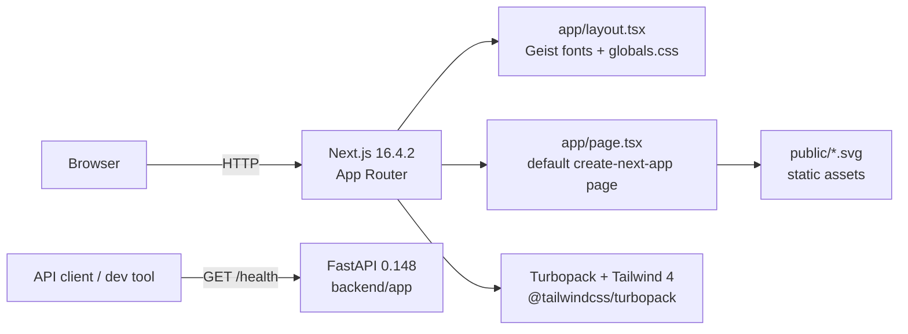
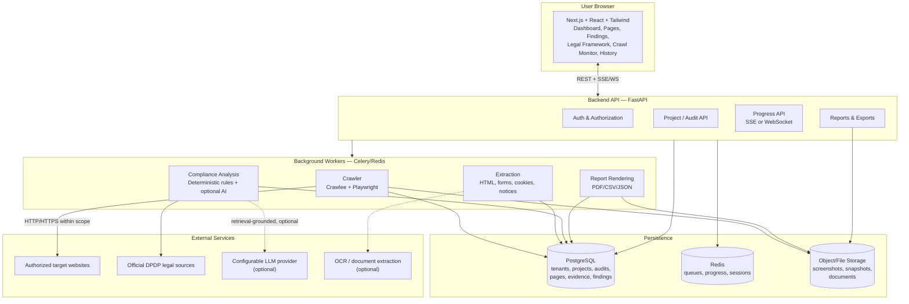
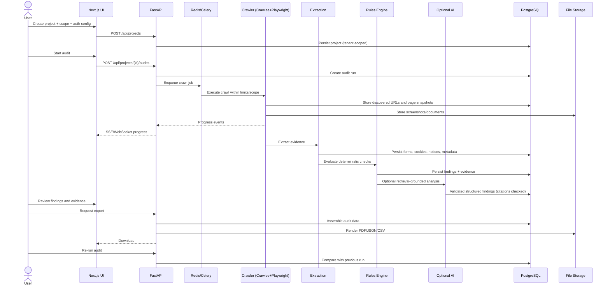

# ARCHITECTURE.md — System Architecture

**Last verified:** 2026-10-19

This document distinguishes **current implementation** (what exists in code) from **target architecture** (what the requirements specify). Do not treat target sections as built.

## 1. Current Architecture (Implemented)

The workspace contains a Next.js 16.4.2 App Router frontend scaffold plus a minimal FastAPI backend. The two are not connected yet.



**Verified facts — frontend:**

- Application root: `dpdp-compliance-auditor/`.
- App Router with `app/` directory (target `src/app/` per DEC-008, migration T-125).
- `app/layout.tsx` defines metadata and loads Geist/Geist Mono via `next/font/google`.
- `app/page.tsx` is the unmodified create-next-app landing page.
- `app/globals.css` imports Tailwind and defines light/dark background and foreground variables.
- `next.config.ts` enables `cacheComponents`, `partialPrefetching`, `experimental.agentFeedback`, and a Turbopack CSS rule.
- No `app/api/` routes, server actions, middleware, or data access layer exist.

**Verified facts — backend (implemented scaffold):**

- Backend root: `C:\projects\website dpdp analyzer\backend\` (workspace root, a standalone service outside the Next.js app; both are tracked in the root Git repository). The virtual environment is `C:\projects\website dpdp analyzer\.venv` (Python 3.12.0, outside Git).
- `backend/app/main.py` creates the FastAPI application; `backend/app/core/config.py` loads settings from environment/`.env`.
- `GET /health` returns service status, name, version, and environment.
- `backend/app/api/health.py` contains the only route.
- Runtime and dev dependencies are installed; see `backend/requirements.txt` and `backend/requirements-dev.txt`.
- `backend/.env.example` documents settings; `backend/.gitignore` excludes `.env`, caches, and build output.
- No database connection, migrations, queue, crawler, auth, compliance rules, or AI provider exists.
- Playwright package is installed, but browser binaries have not been downloaded.

**Location resolved (2026-10-19):** the backend remained at the workspace root as a separate service. It is **not** mixed into the Next.js app. The workspace root is a single Git repository tracking the frontend, backend, and brain. The workspace-root `.venv` stays outside Git; commands from `backend/` use `..\.venv\Scripts\python.exe`. Ruff, pytest (3 passed), and mypy passed from this location. The frontend will call the backend over HTTP.

**Not implemented:** authentication, authorization, multi-tenancy, persistence, crawling, extraction, compliance rules, findings, reports, exports, observability.

## 2. Target Architecture (Planned per Requirements)

The target system is a monorepo with a Next.js frontend, a Python FastAPI backend, PostgreSQL persistence, Redis/Celery background jobs, and a Crawlee/Playwright crawler. AI is optional and advisory.



All target components are **Planned**. None are implemented.

## 3. Component Responsibilities

### 3.1 Frontend (planned target: `src/` feature architecture)

The target Next.js structure separates routing from business functionality. Route files stay thin; domain logic lives in `src/features/`; reusable primitives live in `src/components/`; cross-cutting utilities live in `src/lib/`.

```text
dpdp-compliance-auditor/
├── public/
│   ├── images/
│   └── icons/
│
├── src/
│   ├── app/                         # Next.js routing only
│   │   ├── (auth)/
│   │   │   ├── login/page.tsx
│   │   │   └── register/page.tsx
│   │   │
│   │   ├── (dashboard)/
│   │   │   ├── layout.tsx
│   │   │   ├── dashboard/page.tsx
│   │   │   ├── projects/
│   │   │   │   ├── page.tsx
│   │   │   │   ├── new/page.tsx
│   │   │   │   └── [projectId]/
│   │   │   │       ├── page.tsx
│   │   │   │       ├── settings/page.tsx
│   │   │   │       └── audits/
│   │   │   │           ├── new/page.tsx
│   │   │   │           └── [auditId]/
│   │   │   │               ├── page.tsx
│   │   │   │               ├── crawl/page.tsx
│   │   │   │               ├── pages/page.tsx
│   │   │   │               ├── findings/page.tsx
│   │   │   │               ├── findings/[findingId]/page.tsx
│   │   │   │               ├── legal-mapping/page.tsx
│   │   │   │               └── report/page.tsx
│   │   │   ├── legal-framework/page.tsx
│   │   │   ├── integrations/page.tsx
│   │   │   └── settings/page.tsx
│   │   │
│   │   ├── api/                      # Thin Next.js API routes, if needed
│   │   ├── layout.tsx
│   │   ├── page.tsx
│   │   ├── globals.css
│   │   └── not-found.tsx
│   │
│   ├── features/                     # Business functionality
│   │   ├── dashboard/
│   │   ├── projects/
│   │   ├── audit-configuration/
│   │   ├── crawler/
│   │   ├── page-inventory/
│   │   ├── evidence/
│   │   ├── compliance-findings/
│   │   ├── legal-framework/
│   │   ├── remediation/
│   │   ├── reports/
│   │   ├── audit-history/
│   │   ├── authentication/
│   │   ├── notifications/
│   │   └── settings/
│   │
│   ├── components/
│   │   ├── ui/                       # shadcn/ui primitives
│   │   ├── layout/
│   │   ├── navigation/
│   │   └── shared/
│   │
│   ├── lib/
│   │   ├── api/
│   │   ├── auth/
│   │   ├── env/
│   │   ├── errors/
│   │   ├── formatting/
│   │   └── utils.ts
│   │
│   ├── hooks/                        # Truly shared hooks
│   ├── types/                        # Cross-feature types only
│   └── config/
│
├── tests/
├── .env.example
├── package.json
└── README.md
```

The standalone Python backend is a **sibling** of the Next.js app, not a subdirectory:

```text
C:\projects\website dpdp analyzer\
├── dpdp-compliance-auditor/          # Next.js frontend
├── backend/                          # Independent FastAPI service
│   ├── app/
│   │   ├── api/
│   │   ├── crawler/
│   │   ├── extraction/
│   │   ├── compliance/
│   │   ├── legal_sources/
│   │   ├── reports/
│   │   ├── workers/
│   │   └── security/
│   ├── tests/
│   ├── pyproject.toml
│   ├── requirements.txt
│   └── README.md
├── brain/
└── .venv/                            # Local environment, not committed
```

The frontend integrates through HTTP. Do not nest the backend under `dpdp-compliance-auditor/` or import Python modules from the Next.js app.

**Current deviation:** the scaffold still uses `dpdp-compliance-auditor/app/` at the project root with no `src/` directory and no feature modules. The structure above is the approved target and is not yet implemented. Migration is tracked as T-125 in [TASKS.md](./TASKS.md).

#### Routing layer (`src/app/`)

Route files compose feature modules and handle Next.js concerns (layouts, loading, errors, metadata, params). They must not contain substantive business logic.

| Route | Purpose | Feature module |
| --- | --- | --- |
| `/login`, `/register` | Authentication entry points | `features/authentication` |
| `/dashboard` | Platform overview | `features/dashboard` |
| `/projects` | Project list | `features/projects` |
| `/projects/new` | Create project | `features/projects`, `features/audit-configuration` |
| `/projects/[projectId]` | Project detail and latest audit summary | `features/projects`, `features/audit-history` |
| `/projects/[projectId]/settings` | Project and scope configuration | `features/projects`, `features/audit-configuration` |
| `/projects/[projectId]/audits/new` | Configure and start an audit | `features/audit-configuration`, `features/crawler` |
| `/projects/[projectId]/audits/[auditId]` | Audit summary | `features/compliance-findings`, `features/audit-history` |
| `/projects/[projectId]/audits/[auditId]/crawl` | Live crawl monitor | `features/crawler` |
| `/projects/[projectId]/audits/[auditId]/pages` | Page inventory | `features/page-inventory`, `features/evidence` |
| `/projects/[projectId]/audits/[auditId]/findings` | Findings list | `features/compliance-findings` |
| `/projects/[projectId]/audits/[auditId]/findings/[findingId]` | Finding detail, evidence, remediation, review | `features/compliance-findings`, `features/evidence`, `features/remediation` |
| `/projects/[projectId]/audits/[auditId]/legal-mapping` | Legal provision mapping | `features/legal-framework` |
| `/projects/[projectId]/audits/[auditId]/report` | Report preview and export | `features/reports` |
| `/legal-framework` | Legal framework reference | `features/legal-framework` |
| `/integrations` | Integration configuration (AI, storage, etc.) | `features/settings` |
| `/settings` | Organization/user settings | `features/settings` |

#### Feature modules (`src/features/`)

| Module | Responsibility |
| --- | --- |
| `dashboard` | Aggregated metrics, severity distribution, coverage summary, previous-audit comparison |
| `projects` | Project CRUD, scope, organization context, project settings |
| `audit-configuration` | Crawl limits, auth mode, content types, analysis toggles, legal-framework selection, validation |
| `crawler` | Crawl progress state, live updates, queue/retry/failure display, pause/resume/cancel |
| `page-inventory` | Searchable/filterable URL inventory, page type, status, findings counts |
| `evidence` | Evidence viewer for text, DOM, forms, cookies/scripts, headers, screenshots, redactions |
| `compliance-findings` | Finding list/detail, status, severity, confidence, review workflow, affected URLs |
| `legal-framework` | Provision display, applicability/effective dates, source links, rule version, limitations |
| `remediation` | Remediation guidance, draft copy labeling, verification steps |
| `reports` | Report preview, PDF/JSON/CSV export, reproducibility metadata |
| `audit-history` | Run history, diffs, new/resolved/regressed findings, coverage changes |
| `authentication` | Sign-in, registration, session handling, access guards |
| `notifications` | In-app notifications for audit completion/failures (proposed) |
| `settings` | Organization settings, integrations, user preferences |

#### Shared frontend layers

| Path | Allowed contents |
| --- | --- |
| `src/components/ui/` | shadcn/ui primitives and low-level design-system components |
| `src/components/layout/` | App shell, sidebar, top bar, page containers |
| `src/components/navigation/` | Breadcrumbs, tabs, navigation menus |
| `src/components/shared/` | Reusable cross-feature components without domain logic |
| `src/lib/api/` | API client, request/response types, error mapping |
| `src/lib/auth/` | Session helpers and access guards |
| `src/lib/env/` | Environment variable validation (names only in docs) |
| `src/lib/errors/` | Error normalization and user-safe messages |
| `src/lib/formatting/` | Dates, numbers, URLs, severity/status labels |
| `src/lib/utils.ts` | Small generic utilities |
| `src/hooks/` | Only hooks genuinely shared across features |
| `src/types/` | Only cross-feature types; feature types stay in the feature |
| `src/config/` | App configuration constants and feature flags |

#### Import boundaries

- `src/app/**` may import from `src/features/**`, `src/components/**`, `src/lib/**`.
- Feature modules may import from `src/lib/**`, `src/components/**`, `src/types/**`, and their own internals.
- Feature modules must not deep-import another feature's internals. Cross-feature interaction goes through shared modules or explicit public exports.
- `src/components/**` must not import from `src/features/**`.
- `src/lib/**` must not import from `src/features/**` or `src/app/**`.
- Server-only modules (secrets, API keys, session handling) must never be imported into client components.
- Thin Next.js API routes under `src/app/api/**` may proxy or handle webhooks/session concerns, but the Python backend remains the business API owner.

### 3.2 Backend API (planned)

- Authentication and session management.
- Tenant-aware authorization for every project, audit, page, finding, and report.
- Input validation (Pydantic) and structured errors.
- Pagination, rate limiting, and request scoping.
- Enqueues crawl/analysis jobs; exposes progress via SSE or WebSocket.
- Serves exports and report metadata.

Planned modules from requirements:

```
backend/app/
├── api/            # Route handlers
├── auth/           # Authentication/authorization
├── crawler/        # URL discovery, queueing, limits
├── browser/        # Playwright session management
├── extraction/     # HTML, forms, cookies, notices, documents
├── compliance/
│   ├── rules/      # Versioned rule definitions
│   ├── legal_sources/
│   └── analyzers/  # Deterministic checks
├── ai/             # Provider abstraction, prompts, validation
├── reports/        # PDF/CSV/JSON generation
├── models/         # SQLAlchemy models
├── schemas/        # Pydantic schemas
├── services/       # Domain services
├── workers/        # Celery tasks
├── security/       # SSRF guards, redaction, secrets
└── tests/
```

### 3.3 Crawler (planned)

- Crawlee for Python for queues, deduplication, retries, and concurrency.
- Playwright for JavaScript-rendered pages, authenticated sessions, screenshots, and controlled interaction.
- BeautifulSoup/lxml for HTML parsing.
- Sitemap, robots.txt, canonical, pagination, and anchor-based URL discovery.
- URL normalization and discovery-source tracking.
- Query-parameter controls to avoid infinite crawling (tracking parameters, calendars, faceted filters).
- Hard limits: depth, page count, concurrency, delay, timeout, file size, content types.
- Same-origin-only by default; explicit approved subdomains only.

### 3.4 Extraction (planned)

Collect per page: URL, canonical, HTTP status, title, meta description, headings, visible text, DOM evidence, internal/external links, forms and fields, interactive controls, privacy/cookie links, consent controls, script and third-party resource metadata, screenshots, page type, crawl timestamp, extraction errors.

### 3.5 Compliance Engine (planned)

- Versioned, maintainable rule definitions independent of the LLM.
- Legal references tied to official Indian government publications.
- Each reference includes document, version/date, section/rule, source URL, applicability/commencement, requirement summary, observable indicators, evidence needed, deterministic logic, human-review requirement, remediation, and last-verified date.
- Areas: notices/transparency, consent/choice, personal-data collection, data-principal rights/grievance, children's data, security/data handling, retention/deletion/purpose limitation, third-party sharing, accountability disclosures.
- Findings use a validated structured schema with status (`Pass`, `Potential issue`, `Needs review`, `Not assessed`, `Not applicable`), severity, confidence, evidence, legal references, reasoning, remediation, verification steps, and human-review flag.
- Severity is separate from confidence and must follow a documented rubric.

### 3.6 AI Layer (planned, optional)

- Used for page classification, notice extraction, statement-vs-behavior comparison, missing-information detection, remediation suggestions, summaries, and plain-language explanations.
- Retrieval-grounded pipeline: retrieve official legal text → check applicability → retrieve website evidence → analyze → require structured output → validate citations exist in the legal database → reject unsupported claims → flag uncertainty for human review.
- Website content is untrusted data, never instructions.
- Non-AI fallback mode is required; deterministic checks must work without a paid provider.

### 3.7 Background Jobs (planned)

- Redis + Celery (or equivalent reliable queue).
- Jobs: crawl, extract, analyze, render report, recheck.
- Must support pause, resume, cancel, retry, and progress reporting.
- Progress calculations must be based on real counts, never invented percentages or ETAs.

## 4. Data Flow (Target)



## 5. Authentication and Authorization Architecture (Target)

- User registration/sign-in for the platform.
- Organizations and users with tenant-scoped access.
- Every project, page, finding, and report query must enforce tenant isolation.
- Target-website authentication is separate from platform authentication:
  - Modes: public, credentials-based login, manual browser login.
  - Optional login URL, field selectors, auth instructions.
  - Session/cookie persistence, redirect handling, session-expiration detection, auth-state verification.
  - Manual login in a controlled browser for MFA/CAPTCHA.
  - Secure logout and session cleanup.
- Never bypass MFA, CAPTCHA, or access controls.
- Platform auth implementation (library/provider) is **TBD**.

## 6. Deployment Architecture (Target)

Requirements call for:

- Docker Compose for local development.
- Environment-variable examples.
- Database migrations and seed data.
- Production deployment documentation.
- Frontend, API, worker, PostgreSQL, Redis, and file storage services.

No Docker, deployment config, or environment examples exist today. Hosting target is **TBD**.

## 7. Architectural Boundaries and Invariants

1. UI never talks to PostgreSQL directly.
2. Crawler/browser code is server-side only.
3. Legal rules, evidence, and findings are separate layers.
4. Deterministic checks do not depend on the LLM.
5. AI output is untrusted until schema-validated and citation-verified.
6. All crawl destinations are scope-checked after every redirect and DNS resolution.
7. Secrets are encrypted at rest and redacted in logs/exports.
8. No compliance score without a documented methodology and coverage denominator.
9. `src/app/` owns routing only; business logic belongs in `src/features/`.
10. Feature modules do not deep-import each other; shared code goes through `src/lib/`, `src/components/`, or `src/types/`.
11. The Python backend remains the owner of business APIs; Next.js `src/app/api/` routes stay thin and do not duplicate backend logic.

## 8. Open Architecture Questions

| ID | Question | Status |
| --- | --- | --- |
| AQ-01 | Adopt FastAPI monorepo as specified, or implement the backend in TypeScript within Next.js? | Backend TBD — see [DECISION.md](./DECISION.md); frontend structure approved as `src/` feature architecture (DEC-008) |
| AQ-02 | Which object/file storage provider for screenshots and documents? | TBD |
| AQ-03 | Which LLM provider abstraction and default non-AI behavior? | TBD |
| AQ-04 | Which auth library/provider for platform users? | TBD |
| AQ-05 | How should legal documents be versioned and verified (manual curation, scheduled ingestion, both)? | TBD |
| AQ-06 | What is the documented severity rubric? | TBD |
| AQ-07 | Deployment target (Vercel + managed services, containers, etc.)? | TBD |
| AQ-08 | When should the scaffold migrate from root `app/` to `src/app/` and feature modules? | Tracked as T-125 |

## 9. Related Documents

- [PRD.md](./PRD.md) — requirements and scope.
- [DECISION.md](./DECISION.md) — decision history.
- [DATABASE.md](./DATABASE.md) — data model.
- [API.md](./API.md) — planned endpoints.
- [SECURITY.md](./SECURITY.md) — threat model and controls.
- [FLOW.md](./FLOW.md) — user and system flows.
- [INTEGRATIONS.md](./INTEGRATIONS.md) — external services.
