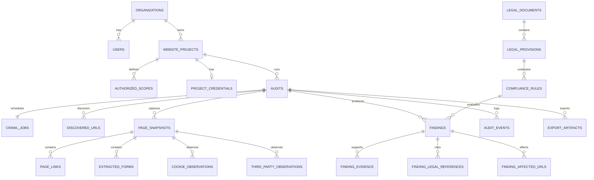

# DATABASE.md — Database Documentation

**Status:** Not yet implemented. No database exists in the repository.

## 1. Current State (Verified)

- No PostgreSQL, SQLite, ORM, or migration tooling is present.
- No schema files, migrations, seeds, or connection configuration exist.
- No database environment variables exist.
- The application currently serves a static page and persists nothing.

The schema below is a **proposed design** derived from the requirements. It must not be treated as the production schema until migration files exist. Migration files and schema definitions will be authoritative once implemented.

## 2. Proposed Technology

| Concern | Proposed choice | Status |
| --- | --- | --- |
| Database | PostgreSQL | Proposed (DEC-003) |
| ORM | SQLAlchemy | Proposed |
| Migrations | Alembic | Proposed |
| Local dev | Docker Compose PostgreSQL service | Proposed |
| Queue/session store | Redis (separate from primary DB) | Proposed |
| File artifacts | Object/file storage (screenshots, snapshots, documents) | TBD |

## 3. Data Model Principles

1. **Tenant-scoped by default.** Every project and all descendants carry `organization_id`.
2. **Audit immutability.** Findings, evidence, and rule versions are tied to an audit run and preserved for reproducibility.
3. **Separation of evidence and interpretation.** Pages/evidence are raw observations; findings are derived conclusions.
4. **Versioned legal data.** Legal documents, provisions, and rules are versioned; audits reference a framework version.
5. **Minimal sensitive data.** Credentials encrypted; form values redacted; retention configurable.
6. **No plaintext passwords.** Ever.
7. **UUID primary keys** to avoid enumeration (recommended).
8. **Timestamps in UTC** with `created_at`/`updated_at`.

## 4. Proposed Schema

> All tables are proposals. Field lists are indicative, not exhaustive migrations.

### 4.1 `organizations`

| Column | Type | Constraints |
| --- | --- | --- |
| `id` | uuid | PK |
| `name` | text | not null |
| `created_at` | timestamptz | not null |
| `updated_at` | timestamptz | not null |

### 4.2 `users`

| Column | Type | Constraints |
| --- | --- | --- |
| `id` | uuid | PK |
| `organization_id` | uuid | FK → organizations.id, not null, indexed |
| `email` | citext/text | unique per organization (or globally, TBD), not null |
| `password_hash` | text | nullable if external auth |
| `display_name` | text | nullable |
| `role` | text/enum | not null (roles TBD) |
| `is_active` | boolean | default true |
| `last_login_at` | timestamptz | nullable |
| `created_at` / `updated_at` | timestamptz | not null |

### 4.3 `website_projects`

| Column | Type | Constraints |
| --- | --- | --- |
| `id` | uuid | PK |
| `organization_id` | uuid | FK → organizations.id, indexed |
| `created_by` | uuid | FK → users.id |
| `name` | text | not null |
| `root_url` | text | not null |
| `auth_mode` | enum | `public`, `credentials`, `manual` |
| `login_url` | text | nullable |
| `auth_instructions` | text | nullable |
| `organization_context` | jsonb | nullable (business context) |
| `legal_framework_version` | text | nullable until audit |
| `crawl_config` | jsonb | depth, pages, concurrency, delay, timeout, scope, content types, toggles |
| `created_at` / `updated_at` | timestamptz | not null |
| `deleted_at` | timestamptz | nullable (soft delete) |

### 4.4 `authorized_scopes`

| Column | Type | Constraints |
| --- | --- | --- |
| `id` | uuid | PK |
| `project_id` | uuid | FK → website_projects.id, indexed |
| `kind` | enum | `origin`, `subdomain`, `path_include`, `path_exclude` |
| `value` | text | not null |
| `created_at` | timestamptz | not null |

### 4.5 `project_credentials`

Encrypted credentials or references. Prefer short-lived credentials and ephemeral profiles.

| Column | Type | Constraints |
| --- | --- | --- |
| `id` | uuid | PK |
| `project_id` | uuid | FK → website_projects.id, unique, indexed |
| `encrypted_payload` | bytea/text | not null |
| `key_version` | text | not null |
| `expires_at` | timestamptz | nullable |
| `created_at` | timestamptz | not null |
| `last_used_at` | timestamptz | nullable |

Never store raw passwords. Rotation and deletion policies are `TBD` (SEC-03).

### 4.6 `crawl_jobs`

| Column | Type | Constraints |
| --- | --- | --- |
| `id` | uuid | PK |
| `audit_id` | uuid | FK → audits.id, indexed |
| `status` | enum | `queued`, `running`, `paused`, `cancelling`, `cancelled`, `completed`, `partial`, `failed` |
| `config_snapshot` | jsonb | not null |
| `started_at` / `finished_at` | timestamptz | nullable |
| `error_code` / `error_message` | text | nullable (redacted) |
| `created_at` | timestamptz | not null |

### 4.7 `discovered_urls`

| Column | Type | Constraints |
| --- | --- | --- |
| `id` | uuid | PK |
| `audit_id` | uuid | FK → audits.id, indexed |
| `normalized_url` | text | not null |
| `url_hash` | text | not null, unique per audit |
| `discovery_sources` | jsonb/text[] | e.g., anchor, sitemap, robots, canonical, pagination, js, seed |
| `depth` | integer | not null |
| `in_scope` | boolean | not null |
| `status` | enum | `queued`, `processing`, `processed`, `failed`, `skipped`, `blocked` |
| `http_status` | integer | nullable |
| `skip_reason` / `error_reason` | text | nullable |
| `created_at` / `updated_at` | timestamptz | not null |

Unique constraint proposal: `(audit_id, url_hash)`.

### 4.8 `page_snapshots`

| Column | Type | Constraints |
| --- | --- | --- |
| `id` | uuid | PK |
| `audit_id` | uuid | FK → audits.id, indexed |
| `discovered_url_id` | uuid | FK → discovered_urls.id |
| `final_url` | text | |
| `canonical_url` | text | nullable |
| `http_status` | integer | nullable |
| `title` | text | nullable |
| `meta_description` | text | nullable |
| `headings` | jsonb | nullable |
| `visible_text` | text | nullable (redacted where required) |
| `dom_excerpt` | text | nullable |
| `html_snapshot_ref` | text | nullable (file storage reference) |
| `page_type` | text | nullable |
| `authenticated` | boolean | default false |
| `screenshot_ref` | text | nullable |
| `extraction_errors` | jsonb | nullable |
| `captured_at` | timestamptz | not null |

### 4.9 `page_links`

| Column | Type | Constraints |
| --- | --- | --- |
| `id` | uuid | PK |
| `page_snapshot_id` | uuid | FK → page_snapshots.id, indexed |
| `target_url` | text | not null |
| `link_type` | enum | `internal`, `external` |
| `anchor_text` | text | nullable |
| `rel` | text | nullable |

### 4.10 `extracted_forms`

| Column | Type | Constraints |
| --- | --- | --- |
| `id` | uuid | PK |
| `page_snapshot_id` | uuid | FK → page_snapshots.id, indexed |
| `action` | text | nullable |
| `method` | text | nullable |
| `form_selector` | text | nullable |
| `fields` | jsonb | name, type, label, required, redacted (never values) |
| `apparent_purpose` | text | nullable |
| `submits_to_third_party` | boolean | nullable |

### 4.11 `cookie_observations`

| Column | Type | Constraints |
| --- | --- | --- |
| `id` | uuid | PK |
| `page_snapshot_id` | uuid | FK → page_snapshots.id, indexed |
| `name` | text | not null |
| `domain` | text | nullable |
| `path` | text | nullable |
| `secure` | boolean | nullable |
| `http_only` | boolean | nullable |
| `same_site` | text | nullable |
| `expiry` | timestamptz | nullable |
| `is_third_party` | boolean | nullable |
| `category` | text | nullable (unknown until classified) |

Cookie **values** must not be stored unless strictly needed and encrypted; prefer hashing/metadata only.

### 4.12 `third_party_observations`

| Column | Type | Constraints |
| --- | --- | --- |
| `id` | uuid | PK |
| `page_snapshot_id` | uuid | FK → page_snapshots.id, indexed |
| `host` | text | not null |
| `resource_type` | text | nullable (script, image, iframe, xhr, etc.) |
| `url` | text | nullable |
| `vendor_guess` | text | nullable |
| `disclosed_in_notice` | boolean | nullable (only after analysis) |

### 4.13 `legal_documents`

| Column | Type | Constraints |
| --- | --- | --- |
| `id` | uuid | PK |
| `title` | text | not null |
| `document_type` | enum | act, rules, notification, amendment |
| `version` | text | not null |
| `publication_date` | date | nullable |
| `effective_date` | date | nullable |
| `source_url` | text | not null (official) |
| `commencement_status` | text | not null (in force / notified / partially effective) |
| `last_verified_at` | date | not null |
| `checksum` | text | nullable |
| `created_at` / `updated_at` | timestamptz | not null |

### 4.14 `legal_provisions`

| Column | Type | Constraints |
| --- | --- | --- |
| `id` | uuid | PK |
| `legal_document_id` | uuid | FK → legal_documents.id, indexed |
| `section_or_rule` | text | not null |
| `heading` | text | nullable |
| `text` | text | not null |
| `source_url` | text | not null |
| `applicability_notes` | text | nullable |
| `effective_date` | date | nullable |
| `created_at` / `updated_at` | timestamptz | not null |

### 4.15 `compliance_rules`

| Column | Type | Constraints |
| --- | --- | --- |
| `id` | uuid | PK |
| `rule_key` | text | not null (stable identifier) |
| `version` | text | not null |
| `category` | text | not null (notice_transparency, consent_choice, etc.) |
| `title` | text | not null |
| `requirement_summary` | text | not null |
| `legal_provision_id` | uuid | FK → legal_provisions.id |
| `observable_indicators` | jsonb | nullable |
| `evidence_needed` | jsonb | nullable |
| `deterministic_logic_ref` | text | nullable (code reference) |
| `human_review_required` | boolean | not null |
| `remediation_guidance` | text | nullable |
| `severity_default` | text/null | nullable; only with rubric |
| `last_verified_at` | date | not null |
| `active` | boolean | default true |
| `created_at` / `updated_at` | timestamptz | not null |

### 4.16 `audits`

| Column | Type | Constraints |
| --- | --- | --- |
| `id` | uuid | PK |
| `project_id` | uuid | FK → website_projects.id, indexed |
| `organization_id` | uuid | FK → organizations.id, indexed |
| `status` | enum | queued, running, paused, cancelled, completed, partial, failed |
| `legal_framework_version` | text | not null |
| `config_snapshot` | jsonb | not null |
| `ai_enabled` | boolean | not null |
| `counts` | jsonb | discovered, processed, failed, skipped, checks_completed, needs_review |
| `coverage_denominator` | text/integer | definition and value |
| `started_at` / `finished_at` | timestamptz | nullable |
| `created_at` | timestamptz | not null |

### 4.17 `findings`

| Column | Type | Constraints |
| --- | --- | --- |
| `id` | uuid | PK |
| `audit_id` | uuid | FK → audits.id, indexed |
| `rule_id` | uuid | FK → compliance_rules.id |
| `finding_key` | text | stable key for cross-run matching |
| `title` | text | not null |
| `category` | text | not null |
| `status` | enum | `pass`, `potential_issue`, `needs_review`, `not_assessed`, `not_applicable` |
| `severity` | enum | `critical`, `high`, `medium`, `low`, nullable |
| `confidence` | numeric(3,2) | 0–1 |
| `reasoning` | text | not null |
| `recommended_fix` | text | nullable |
| `verification_steps` | jsonb | nullable |
| `human_review_required` | boolean | not null |
| `review_status` | text | nullable |
| `assigned_reviewer_id` | uuid | FK → users.id, nullable |
| `resolution_notes` | text | nullable |
| `created_at` / `updated_at` | timestamptz | not null |

### 4.18 `finding_evidence`

| Column | Type | Constraints |
| --- | --- | --- |
| `id` | uuid | PK |
| `finding_id` | uuid | FK → findings.id, indexed |
| `page_snapshot_id` | uuid | FK → page_snapshots.id, nullable |
| `evidence_type` | text | page_text, dom, form, cookie, header, screenshot, document |
| `description` | text | not null |
| `source_url` | text | not null |
| `evidence_location` | text | nullable (selector/heading) |
| `excerpt` | text | nullable (redacted) |
| `artifact_ref` | text | nullable |
| `captured_at` | timestamptz | not null |

### 4.19 `finding_legal_references`

| Column | Type | Constraints |
| --- | --- | --- |
| `id` | uuid | PK |
| `finding_id` | uuid | FK → findings.id, indexed |
| `legal_provision_id` | uuid | FK → legal_provisions.id |
| `applicability_note` | text | nullable |
| `verified` | boolean | not null default false |

### 4.20 `finding_affected_urls`

| Column | Type | Constraints |
| --- | --- | --- |
| `finding_id` | uuid | FK → findings.id |
| `url` | text | not null |
| `page_snapshot_id` | uuid | FK → page_snapshots.id, nullable |

Composite PK proposal: `(finding_id, url)`.

### 4.21 `audit_events`

Append-only audit trail for status changes, exports, reviews, and security-relevant actions.

| Column | Type | Constraints |
| --- | --- | --- |
| `id` | uuid | PK |
| `audit_id` | uuid | FK → audits.id, indexed |
| `actor_id` | uuid | FK → users.id, nullable for system |
| `event_type` | text | not null |
| `payload` | jsonb | redacted |
| `created_at` | timestamptz | not null |

### 4.22 `export_artifacts`

| Column | Type | Constraints |
| --- | --- | --- |
| `id` | uuid | PK |
| `audit_id` | uuid | FK → audits.id, indexed |
| `format` | enum | pdf, json, csv |
| `artifact_ref` | text | not null |
| `created_by` | uuid | FK → users.id |
| `created_at` | timestamptz | not null |
| `expires_at` | timestamptz | nullable |

## 5. Relationships (Proposed)

## 6. Indexes (Proposed)

| Table | Index |
| --- | --- |
| `users` | `(organization_id, email)` unique |
| `website_projects` | `(organization_id, created_at desc)` |
| `audits` | `(project_id, created_at desc)`, `(organization_id, status)` |
| `discovered_urls` | `(audit_id, url_hash)` unique, `(audit_id, status)` |
| `page_snapshots` | `(audit_id)`, `(discovered_url_id)` |
| `findings` | `(audit_id, severity)`, `(audit_id, status)`, `(audit_id, finding_key)` |
| `finding_evidence` | `(finding_id)` |
| `compliance_rules` | `(rule_key, version)` unique, `(category, active)` |
| `legal_provisions` | `(legal_document_id, section_or_rule)` |
| `audit_events` | `(audit_id, created_at)` |

## 7. Migrations and Seed Data (Not Implemented)

Proposed workflow once adopted:

1. Alembic environment configured in `backend/`.
2. Every schema change requires a migration file.
3. No manual production schema edits.
4. Seed data includes legal documents/provisions and rule catalog — not user data.
5. Migrations must be reversible or explicitly documented as irreversible.
6. CI applies migrations to a clean database.

No migrations or seeds exist today.

## 8. Tenant Isolation and Access Policies

- Application-level authorization is mandatory on every query.
- Proposed PostgreSQL row-level security (RLS) as defense in depth: projects, audits, snapshots, findings, evidence, exports scoped by `organization_id` via session context.
- Service accounts and workers must carry tenant context; background jobs must never cross tenants.
- Cross-tenant access attempts should be denied and logged in `audit_events`.
- Database credentials must be least-privilege and never embedded in code.

RLS is proposed, not implemented.

## 9. Retention, Backup, and Lifecycle (Proposed)

| Data | Proposed retention | Notes |
| --- | --- | --- |
| Project credentials | Until audit completion or expiry; delete promptly | Prefer ephemeral |
| Browser sessions/profiles | Destroy after audit/cancel/failure | No reuse |
| Screenshots/HTML snapshots | Configurable; default `TBD` | Deletion controls required |
| Findings/evidence | Retain for audit history | Reproducibility |
| Export artifacts | Short-lived signed URLs | `TBD` expiry |
| Audit events | Longer retention | Security/audit needs |
| Deleted projects | Soft delete then purge | Grace period `TBD` |

Backups: `TBD`. Encryption at rest: `TBD`. Data residency: `TBD`.

## 10. Open Database Decisions

| ID | Question | Status |
| --- | --- | --- |
| DB-01 | UUID vs other key strategy | Proposed UUID |
| DB-02 | RLS vs application-only isolation | TBD |
| DB-03 | File storage provider | TBD |
| DB-04 | Whether to store HTML snapshots in DB or object storage | TBD (recommend object storage) |
| DB-05 | Cookie value storage policy | TBD (recommend metadata only) |
| DB-06 | Retention defaults | TBD |
| DB-07 | Encryption/key management | TBD |
| DB-08 | Legal corpus ingestion and versioning process | TBD |

## 11. Related Documents

- [ARCHITECTURE.md](./ARCHITECTURE.md) — system context.
- [SECURITY.md](./SECURITY.md) — encryption, isolation, retention requirements.
- [API.md](./API.md) — data exposed through APIs.
- [PRD.md](./PRD.md) — requirements for data capture.
- [TASKS.md](./TASKS.md) — implementation tasks T-004, T-050, T-061.
