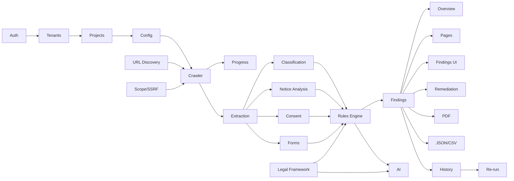

# FEATURES.md — Feature Registry

**Last verified:** 2026-10-19

Status is based on actual source code and test evidence, not on dependencies or intent.

- **Implemented** — verified working code exists.
- **Partial** — some real code exists but the feature is incomplete.
- **Planned** — in requirements/tasks, not built.
- **Blocked** — cannot proceed without a decision/dependency.
- **Deprecated** — should not be used.

## Current Implementation Summary

The first product slice is implemented: the home page accepts a public URL, the backend fetches that single page, and the UI displays its elements and privacy signals. There is still no database, multi-page crawler, compliance engine, AI layer, authentication, or frontend test suite.

---

## F-000 — Next.js Application Scaffold

- **Description:** Runnable Next.js 16.4.2 App Router project with TypeScript, Tailwind 4, ESLint, and Geist fonts.
- **Purpose:** Base for the frontend.
- **Status:** **Implemented**
- **Related files:** `dpdp-compliance-auditor/package.json`, `next.config.ts`, `tsconfig.json`, `eslint.config.mjs`, `app/layout.tsx`, `app/globals.css`.
- **Dependencies:** Node.js, npm.
- **Acceptance criteria:** `npm run dev` starts; `npm run build` succeeds; `npm run lint` runs.
- **Evidence:** Files exist. Build/lint not run during documentation creation (see [CHANGES_LOG.md](./CHANGES_LOG.md)).
- **Notes:** `app/page.tsx` is still the create-next-app default page. Metadata is default.

---

## F-001 — Static Landing Page

- **Description:** Default create-next-app page linking to Next.js/Vercel resources.
- **Purpose:** Placeholder only.
- **Status:** **Implemented (placeholder)** — not a product feature.
- **Related files:** `app/page.tsx`, `public/*.svg`.
- **Acceptance criteria:** Not applicable; must be replaced.
- **Tests:** None.

---

## F-002 — User Registration and Sign-In

- **Description:** Platform account creation and authentication.
- **Status:** **Planned** (P0)
- **Related modules:** `backend/app/auth/` (planned), frontend auth screens (planned).
- **Dependencies:** Auth provider/library decision (SEC-01).
- **Acceptance criteria:** Register, sign in, sign out, session persistence, secure password hashing, invalid-credential handling.
- **Related tasks:** T-010.
- **Tests:** Proposed in [TESTCASE.md](./TESTCASE.md).

## F-003 — Organizations and Tenant Isolation

- **Description:** Multi-tenant organizations with isolated projects, audits, findings, and reports.
- **Status:** **Planned** (P0)
- **Dependencies:** F-002, database schema.
- **Acceptance criteria:** Cross-tenant access denied on every resource; authorization tested.
- **Related tasks:** T-011, T-051.
- **Tests:** Proposed.

## F-004 — Project Management

- **Description:** Create/list/view website audit projects with scope and crawl configuration.
- **Status:** **Planned** (P0)
- **Related modules:** projects API, database, UI.
- **Dependencies:** F-002, F-003, F-005.
- **Acceptance criteria:** All configuration fields from PRD FR-2.2 persist and validate; safe defaults; invalid URLs rejected; authorization attestation required.
- **Related tasks:** T-020, T-021.
- **Tests:** Proposed.

## F-005 — Website Audit Configuration Form

- **Description:** Form for project name, root URL, credentials/auth mode, crawl limits, scope, content types, toggles, legal framework version, business context.
- **Status:** **Planned** (P0)
- **Dependencies:** F-004.
- **Acceptance criteria:** Every field validated; same-origin-only default on; credential inputs handled securely; accessible labels and errors.
- **Related tasks:** T-021.
- **Tests:** Proposed.

## F-006 — URL Discovery and Normalization

- **Description:** Discover URLs via links, sitemaps, robots.txt, canonicals, pagination, JS-rendered links, menus, seed URLs, authenticated pages; normalize and deduplicate with discovery-source tracking.
- **Status:** **Planned** (P0)
- **Dependencies:** Crawler infrastructure.
- **Acceptance criteria:** Deterministic normalization; query-parameter controls; no duplicate page processing; discovery source stored.
- **Related tasks:** T-030.
- **Tests:** Proposed (unit + integration).

## F-007 — Scope and SSRF Enforcement

- **Description:** Same-origin default, approved subdomains, private-network/metadata blocking, redirect and DNS-rebinding protection.
- **Status:** **Planned** (P0)
- **Dependencies:** F-006.
- **Acceptance criteria:** Blocked destinations rejected before request and after redirects; scope escapes logged; tests cover loopback/private/metadata.
- **Related tasks:** T-031, T-050.
- **Tests:** Proposed security tests.

## F-008 — Crawler with Limits and Retries

- **Description:** Crawlee/Playwright crawler enforcing depth, page count, concurrency, delay, timeout, file size, and content types.
- **Status:** **Planned** (P0)
- **Dependencies:** F-006, F-007.
- **Acceptance criteria:** Limits honored; retries bounded; failures recorded per URL; crawl remains within scope.
- **Related tasks:** T-032.
- **Tests:** Proposed.

## F-009 — Authenticated Crawling

- **Description:** Public, credentials-based, and manual browser login; session persistence, expiry detection, auth-state verification, secure cleanup.
- **Status:** **Planned** (P1)
- **Dependencies:** F-008, credential encryption.
- **Acceptance criteria:** Login success is verified beyond form submission; expired sessions detected; no MFA/CAPTCHA bypass; credentials never logged.
- **Related tasks:** T-033.
- **Tests:** Proposed (local test site).

## F-010 — Live Crawl Progress and Controls

- **Description:** Live discovered/processed/failed/skipped counts, current URL, queue depth, retries, activity, pause/resume/cancel.
- **Status:** **Planned** (P0)
- **Dependencies:** F-008, background queue, SSE/WebSocket.
- **Acceptance criteria:** Updates reflect actual state; controls change job state; no invented percentages/ETAs.
- **Related tasks:** T-034, T-043.
- **Tests:** Proposed.

## F-011 — Page Extraction

- **Description:** Extract URL, canonical, status, title, meta, headings, text, DOM evidence, links, forms, controls, privacy/cookie links, consent controls, scripts/third-party metadata, screenshots, page type, timestamp, errors.
- **Status:** **Planned** (P0)
- **Dependencies:** F-008.
- **Acceptance criteria:** Each item persisted where available; inaccessible content not claimed; sensitive form values redacted.
- **Related tasks:** T-040, T-041.
- **Tests:** Proposed.

## F-012 — Document and OCR Processing

- **Description:** Safely download/parse PDFs and common documents; OCR for image-based notices.
- **Status:** **Planned** (P2)
- **Dependencies:** Extraction pipeline, size/type limits.
- **Acceptance criteria:** Type/size validation; parse failures reported; OCR output marked as such.
- **Related tasks:** T-042.
- **Tests:** Proposed.

## F-013 — Page Classification

- **Description:** Classify pages (e.g., home, privacy policy, terms, contact, login, form, checkout, account).
- **Status:** **Planned** (P1)
- **Dependencies:** F-011.
- **Acceptance criteria:** Deterministic baseline; AI augmentation optional; classification confidence/limitations recorded.
- **Related tasks:** T-044.
- **Tests:** Proposed.

## F-014 — Privacy Notice Analysis

- **Description:** Detect notice presence/discoverability and extract statements about purposes, data categories, consent/withdrawal, contact/grievance, rights, retention, third parties, children.
- **Status:** **Planned** (P1)
- **Dependencies:** F-011, F-013, legal framework.
- **Acceptance criteria:** Evidence-linked extraction; missing information flagged as potential/needs review, not violation.
- **Related tasks:** T-045.
- **Tests:** Proposed.

## F-015 — Consent and Cookie Analysis

- **Description:** Observe consent mechanisms, optional purposes, withdrawal controls, consent-dependent behavior, cookie attributes and third-party scripts.
- **Status:** **Planned** (P1)
- **Dependencies:** F-008, F-011.
- **Acceptance criteria:** Observations labeled as observed behavior; no claim of legal violation from technical absence alone.
- **Related tasks:** T-046.
- **Tests:** Proposed.

## F-016 — Form and Personal-Data Collection Analysis

- **Description:** Identify forms/fields collecting personal data, apparent purpose, potentially unnecessary fields, third-party submission, sensitive evidence.
- **Status:** **Planned** (P1)
- **Dependencies:** F-011.
- **Acceptance criteria:** Field inventory with redaction; unnecessary-field concerns marked for human review.
- **Related tasks:** T-047.
- **Tests:** Proposed.

## F-017 — Rights, Grievance, Children, Retention, Third-Party, Accountability Checks

- **Description:** Assess discoverable mechanisms for rights/grievance, age-related controls, retention/deletion statements, third-party disclosures, organizational contact disclosures.
- **Status:** **Planned** (P1)
- **Dependencies:** F-014, F-015, F-016, legal framework.
- **Acceptance criteria:** Applicability questions separated from observations; specialist-review flags where required.
- **Related tasks:** T-048.
- **Tests:** Proposed.

## F-018 — Security and Data-Handling Indicators

- **Description:** Limited authorized checks: HTTPS/TLS indicators, security headers, exposed directory listings/public sensitive files, public secrets/PII indicators, insecure form submission, third-party transmission, cookie attributes.
- **Status:** **Planned** (P1)
- **Dependencies:** Crawler/extraction.
- **Acceptance criteria:** Non-intrusive only; no exploitation; results labeled indicators, not violations.
- **Related tasks:** T-049.
- **Tests:** Proposed.

## F-019 — Versioned DPDP Legal Framework

- **Description:** Maintain official legal documents, provisions, versions, applicability, commencement/effective dates, source URLs, last-verified dates.
- **Status:** **Planned** (P1)
- **Dependencies:** Legal curation process.
- **Acceptance criteria:** Every rule references a verified provision; in-force vs not-yet-effective distinguished; version selectable per audit.
- **Related tasks:** T-060, T-061.
- **Tests:** Proposed (legal-reference validation).

## F-020 — Deterministic Compliance Rules Engine

- **Description:** LLM-independent rule definitions and analyzers producing evidence-based findings.
- **Status:** **Planned** (P1)
- **Dependencies:** F-017, F-019.
- **Acceptance criteria:** Runs without AI; deterministic outputs; schema-validated findings; severity rubric applied.
- **Related tasks:** T-062.
- **Tests:** Proposed.

## F-021 — Evidence-Based Finding Model

- **Description:** Pydantic-validated finding schema with status/severity/confidence/evidence/legal references/reasoning/remediation/verification/human review.
- **Status:** **Planned** (P0 schema / P1 engine)
- **Dependencies:** Database, rules engine.
- **Acceptance criteria:** Required fields enforced; enums validated; evidence tied to source URL; severity and confidence independent.
- **Related tasks:** T-063.
- **Tests:** Proposed (schema validation).

## F-022 — AI-Assisted Analysis

- **Description:** Optional LLM tasks with retrieval-grounded legal analysis, structured output, citation validation, uncertainty flags.
- **Status:** **Planned** (P2)
- **Dependencies:** F-019, F-020, F-021, provider abstraction.
- **Acceptance criteria:** No AI required for core checks; citations validated; untrusted content isolated; unsupported claims rejected.
- **Related tasks:** T-070, T-071, T-072.
- **Tests:** Proposed (prompt injection, citation validation).

## F-023 — Overview Dashboard

- **Description:** Metrics, severity distribution, coverage with denominator, last audit, previous comparison.
- **Status:** **Planned** (P1)
- **Dependencies:** APIs and persistence.
- **Acceptance criteria:** Real data only; no arbitrary compliance score; coverage methodology documented.
- **Related tasks:** T-080.
- **Tests:** Proposed.

## F-024 — Pages Dashboard

- **Description:** Searchable/filterable page inventory and evidence viewer.
- **Status:** **Planned** (P1)
- **Dependencies:** F-011.
- **Acceptance criteria:** Filters for auth/errors/risk; evidence viewer shows source and redactions.
- **Related tasks:** T-081.
- **Tests:** Proposed.

## F-025 — Findings Dashboard and Review Workflow

- **Description:** Finding list/detail, reviewer assignment, status, resolution notes.
- **Status:** **Planned** (P1)
- **Dependencies:** F-021.
- **Acceptance criteria:** All finding fields displayed; review state persists; authorization enforced.
- **Related tasks:** T-082.
- **Tests:** Proposed.

## F-026 — Legal Framework Dashboard

- **Description:** Display applicable provisions, effective dates, source documents, rule version, limitations.
- **Status:** **Planned** (P2)
- **Dependencies:** F-019.
- **Acceptance criteria:** Version and applicability visible; sources link to official documents.
- **Related tasks:** T-083.
- **Tests:** Proposed.

## F-027 — Crawl Monitor UI

- **Description:** Live progress, current URL, queue depth, retries, failures, controls, exportable redacted logs.
- **Status:** **Planned** (P1)
- **Dependencies:** F-010.
- **Acceptance criteria:** Controls functional; logs redacted; no fabricated ETA.
- **Related tasks:** T-084.
- **Tests:** Proposed.

## F-028 — Audit History and Comparison

- **Description:** Previous runs, changed/new/resolved findings, coverage changes, regression checks.
- **Status:** **Planned** (P2)
- **Dependencies:** Audit run persistence, recheck.
- **Acceptance criteria:** Comparison accurate by finding identity/evidence; coverage changes shown.
- **Related tasks:** T-085, T-095.
- **Tests:** Proposed.

## F-029 — Remediation Guidance

- **Description:** Structured remediation per finding with what/where/why/requirement/change/example/test/limitations; draft notice copy.
- **Status:** **Planned** (P1)
- **Dependencies:** F-021, F-019.
- **Acceptance criteria:** Generated copy labeled draft; no automatic modification of target site.
- **Related tasks:** T-086.
- **Tests:** Proposed.

## F-030 — PDF Report Export

- **Description:** Executive summary, scope, coverage/limitations, methodology, prioritized findings, URLs, evidence/screenshots, legal refs, remediation, review questions, framework version, timestamp.
- **Status:** **Planned** (P2)
- **Dependencies:** F-021, report renderer.
- **Acceptance criteria:** Reproducible by audit ID; redacted; includes limitations.
- **Related tasks:** T-090.
- **Tests:** Proposed.

## F-031 — JSON and CSV Export

- **Description:** Machine-readable JSON report; CSV findings and page inventory.
- **Status:** **Planned** (P2)
- **Dependencies:** Persistence.
- **Acceptance criteria:** Schema versioned; CSV injection safe; redaction applied.
- **Related tasks:** T-091.
- **Tests:** Proposed.

## F-032 — Pause/Resume/Cancel and Recovery

- **Description:** Audit lifecycle control and worker recovery.
- **Status:** **Planned** (P1)
- **Dependencies:** Background queue.
- **Acceptance criteria:** State transitions enforced; cancellation cleans up credentials/sessions; interrupted jobs recover safely.
- **Related tasks:** T-035.
- **Tests:** Proposed.

## F-033 — Re-run Selected Checks or Full Audit

- **Description:** Re-run checks or entire audit after remediation.
- **Status:** **Planned** (P2)
- **Dependencies:** F-020, F-028.
- **Acceptance criteria:** New audit run created; prior evidence preserved; comparison available.
- **Related tasks:** T-095.
- **Tests:** Proposed.

## F-034 — Docker Compose and Environment Setup

- **Description:** Local development environment, env examples, migrations, seed data, setup/deployment docs.
- **Status:** **Planned** (P0)
- **Dependencies:** Backend stack decision.
- **Acceptance criteria:** One-command local startup; no secrets committed; documented prerequisites.
- **Related tasks:** T-100, T-101.
- **Tests:** Manual smoke test.

## F-035 — Automated Test Suite and Local Test Site

- **Description:** Unit/integration/E2E/security tests and a synthetic local test website with privacy notices, forms, cookie banners, and deliberate gaps.
- **Status:** **Planned** (P0/P1)
- **Dependencies:** Stack.
- **Acceptance criteria:** CI-runnable; synthetic data only; covers required test areas.
- **Related tasks:** T-110–T-114.
- **Tests:** Self.

---

## F-036 — Backend Runtime Foundation

- **Description:** FastAPI application factory, settings via pydantic-settings, `/health` endpoint, pytest/ruff/mypy configuration, and dependency manifests installed into the workspace venv.
- **Purpose:** Provide a runnable backend base for product features.
- **Status:** **Implemented (scaffold)**
- **Related files:** `backend/app/main.py`, `backend/app/core/config.py`, `backend/app/api/health.py`, `backend/main.py`, `backend/requirements.txt`, `backend/requirements-dev.txt`, `backend/pyproject.toml`, `backend/.env.example`, `backend/.gitignore`, `backend/README.md`, `backend/tests/test_health.py`, `backend/tests/test_config.py`.
- **Dependencies:** Python 3.12, workspace `.venv`.
- **Acceptance criteria:** App starts; `GET /health` returns status; lint/type/test checks run.
- **Evidence:** 2026-10-19 — ruff passed, pytest 3 passed, mypy passed, live `/health` returned `status: ok`.
- **Limitations:** No database, queue, auth, projects/audits API, crawler, or compliance logic. The backend is a standalone service at the workspace root and is not part of the Next.js application.

---

## F-037 — Landing Page Element Inspector

- **Description:** `POST /api/analyze-landing` fetches one public HTML page and returns metadata, common element counts, headings, links, images, forms and fields, scripts, iframes, and surface-level privacy signals. The Next.js home page provides the URL form and renders the results.
- **Purpose:** Give users an immediate, evidence-based view of what a landing page contains before building the full audit workflow.
- **Status:** **Removed** (2026-10-19). The endpoint, backend modules, tests, and frontend UI were deleted; superseded by the TypeScript evidence-based audit engine (see "Implemented Slice" below).
- **Former files (deleted):** `backend/app/api/analysis.py`, `backend/app/schemas/landing.py`, `backend/app/services/landing_analyzer.py`, `backend/app/security/url_safety.py`, `backend/tests/test_landing_analyzer.py`, `backend/tests/test_analysis_api.py`, `dpdp-compliance-auditor/components/landing-analyzer.tsx`.
- **Dependencies:** F-036.
- **Acceptance criteria:** A public HTML URL produces a structured element report; private/loopback targets and non-HTML responses are rejected; the UI displays summary counts, element sections, and privacy signals.
- **Evidence (observed 2026-10-19):**
  - Backend: ruff passed; mypy passed; pytest `14 passed`.
  - Frontend: `npm run lint` passed; `npm run build` passed.
  - Live API: `https://www.python.org/` returned 200, 14 headings, 150 links, 831 elements, and a detected privacy link.
- **Limitations:**
  - Single static HTML response only; no crawling, JavaScript rendering, authenticated pages, or form submission.
  - Link lists are capped at 150, images at 100, scripts at 100, iframes at 50, forms at 20, and form fields at 50 per form.
  - No auth, rate limiting, or quota; DNS-rebinding TOCTOU remains a residual SSRF risk.
  - Privacy signals are keyword/link heuristics, not compliance conclusions.
- **Related tasks:** T-127.

---

## F-038 — Report Verification and Coverage Transparency

- **Description:** Consolidated findings, explicit claim-type labels, four independent coverage measures, per-provision commencement dates, and full structured evidence in the PDF/CSV exports.
- **Purpose:** Make exported reports and the dashboard verifiable and honest — no duplicate-looking findings, no best-practice check presented as a legal obligation, no not-yet-in-force provision implied as a current breach, and no single number mistaken for a compliance score.
- **Status:** **Implemented** (2026-10-19).
- **Related files:** `lib/audit/groups.ts`, `lib/audit/presentation.ts`, `lib/audit/summary.ts` (`computeAuditCoverage`), `lib/audit/legal.ts`, `lib/audit/registry.ts` (`defaultClaimType`), `lib/audit/runner.ts` (`findingGroups`), `lib/audit/export.ts`, `components/audit/audit-report.tsx`.
- **Acceptance criteria:** Related checks render as one consolidated finding (all tests still listed); every result carries a `claimType`; coverage is reported as page crawl, site discovery, test execution and evidence sufficiency; each provision shows its own effective date/commencement group; the PDF and CSV include the evidence JSON.
- **Evidence (observed 2026-10-19):** `npx tsc --noEmit` clean; `npm run lint` clean; `npm test` → 84 passed (12 files); `npm run build` passed.
- **Limitations:** Groups show the primary test's remediation/reasoning; category `J` items are labelled "regulatory readiness" (covers not-yet-in-force provisions and externally-unverifiable controls).
- **Related tasks:** T-136; [DEC-015](./DECISION.md)–[DEC-018](./DECISION.md).

## F-039 - Uncapped Crawl Budget and Credential-Gated Continuation

- **Description:** Crawl a site without operator-set page/depth caps until its same-site link graph is exhausted or a fixed 5-minute budget expires, and support sites behind a single username/password login by detecting the wall, prompting for credentials, and running a new authenticated audit.
- **Purpose:** Cover the whole reachable site while guaranteeing a bounded run, report slow-loading or size-driven truncation honestly, and avoid dead "failed" audits for login-protected sites without storing secrets.
- **Status:** **Implemented** (2026-10-20).
- **Related files:** `lib/audit/crawler.ts`, `lib/audit/runner.ts`, `lib/audit/auth.ts`, `lib/audit/login-wall.ts`, `lib/audit/launcher.ts`, `workers/audit-worker.ts`, `app/api/audits/route.ts`, `app/api/audits/[id]/credentials/route.ts`, `components/audit/{new-audit-form,credentials-prompt,audit-report,audit-live,status-badge}.tsx`.
- **Acceptance criteria:** No max-pages/max-depth inputs or API fields; crawls stop at `ENGINE_TIME_BUDGET_MS` with an explicit limitation and `partial`/`failed` status; a login wall yields `requires_credentials` with 0 tests; a login page discovered on an otherwise public site is surfaced in the report with an optional authenticated run; credentials queue a new run, are streamed over stdin, and never appear in `run.json`; single username/password login succeeds and cookie-authenticated pages are crawled; MFA/CAPTCHA/SSO is refused with a reason; `robots.txt`/`sitemap.xml` status is rendered as a large, labelled card.
- **Evidence (observed 2026-10-20):** `npx tsc --noEmit` clean; `npm run lint` clean; `npm test` → 94 passed (13 files); `npm run build` passed. Local login fixture: unauth → `requires_credentials`; auth → `completed`, 75 tests, `/privacy` reached. `https://example.com/` → `completed`, 75 tests. Spawned-worker stdin handoff → `completed`, 75 tests, no password value in the stored run. `www.mockmingle.in` run normalizes to `loginSurfaceDetected: true` at `/login`.
- **Limitations:** Only single-step username/password forms are supported (no MFA, CAPTCHA, or SSO). Large sites are truncated at 5 minutes. Authenticated session/logout behaviour is not modelled beyond reusing cookies for the run.
- **Related tasks:** T-137; [DEC-019](./DECISION.md)–[DEC-022](./DECISION.md).

## F-040 - Live Run Log and Worker Console Suppression

- **Description:** Persist a timestamped progress log for every audit (worker start, each URL with attempted/fetched/failed/queued counts, sign-in steps, crawl summary, evaluation) and show it live on the audit page. Spawn the worker without a visible Windows console.
- **Purpose:** Make long crawls observable and diagnosable, and stop a terminal window opening on every run.
- **Status:** **Implemented** (2026-10-20).
- **Related files:** `lib/audit/{types,crawler,runner,auth,launcher,store}.ts`, `workers/audit-worker.ts`, `components/audit/{audit-progress,audit-report,audit-live}.tsx`.
- **Acceptance criteria:** `run.progress` records start/page/complete/login events; the audit page polls every 1.5 s and shows a live log with counts; sign-in diagnostics are stored on `auth` and shown on failures; the worker is spawned with `detached: false` and `windowsHide: true`; legacy runs normalize to an empty log.
- **Evidence (observed 2026-10-20):** `npx tsc --noEmit` clean; `npm run lint` clean; `npm test` → 94 passed (13 files); `npm run build` passed. Spawned worker against `https://example.com/` persisted 6 progress entries and finished `completed` (1 page, 75 tests).
- **Limitations:** Link discovery remains static, so client-rendered pages that appear only after JavaScript sign-in may still not be crawled. Browser-based link discovery is not implemented.
- **Related tasks:** T-138; [DEC-023](./DECISION.md).

---

## Feature Dependency Overview

## Implemented Slice (2026-10-20) — TypeScript Evidence-Based Audit Engine

The landing-page inspector was removed on 2026-10-19. The TypeScript audit engine is now the only analysis slice inside `dpdp-compliance-auditor/`:

- **Implemented:** same-origin crawler with a fixed 5-minute run budget and no page/depth caps (`lib/audit/crawler.ts`); login-wall detection and single username/password sign-in (`lib/audit/login-wall.ts`, `lib/audit/auth.ts`); URL safety (`lib/audit/url.ts`); redaction (`lib/audit/redact.ts`); evidence types (`lib/audit/types.ts`); versioned 75-test registry (`lib/audit/registry.ts`); verified legal references with per-provision commencement (`lib/audit/legal.ts`); deterministic rule evaluators (`lib/audit/rules/`); runner (`lib/audit/runner.ts`); coverage summary, four independent coverage measures, and a plain-language readiness outcome without a compliance score (`lib/audit/summary.ts`, `deriveAuditOutcome`); finding consolidation (`lib/audit/groups.ts`, `lib/audit/presentation.ts`); claim-type labels (`CLAIM_TYPES`); single export dropdown (`components/audit/export-menu.tsx`); file store (`lib/audit/store.ts`); worker queue and stdin credential handoff (`lib/audit/launcher.ts`, `workers/audit-worker.ts`); JSON/CSV/PDF exports with full evidence (`lib/audit/export.ts`); finding screenshots / visual evidence (`lib/audit/screenshots.ts`, `components/audit/screenshot-gallery.tsx`, `app/api/audits/[id]/screenshots/[name]/route.ts`); API routes (`app/api/audits/`); dashboard, detail, and compare pages (`app/audits/`); audit UI components (`components/audit/`).
- **Partial:** optional Playwright browser evidence (`lib/audit/browser.ts`); browser binaries are now installed locally (`npx playwright install chromium`) but the feature degrades to `NOT_ASSESSED` when they are absent. The Prisma PostgreSQL schema exists but no adapter or migrations are wired.
- **Not implemented:** Redis/BullMQ queue, LLM analysis, scheduled/recurring audits, organizational-evidence ingestion, authentication, rate limiting, and tenant isolation.

**Verification (observed 2026-10-20):** `npx tsc --noEmit` passed; `npm run lint` passed with no warnings; `npm test` → 90 passed across 13 files; `npm run build` passed.

## Related Documents

- [PRD.md](./PRD.md) — requirements and acceptance context.
- [TASKS.md](./TASKS.md) — implementation tasks.
- [TESTCASE.md](./TESTCASE.md) — test coverage.
- [FLOW.md](./FLOW.md) — flows behind features.
