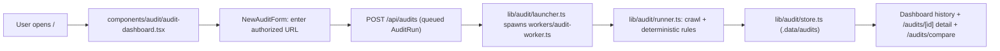
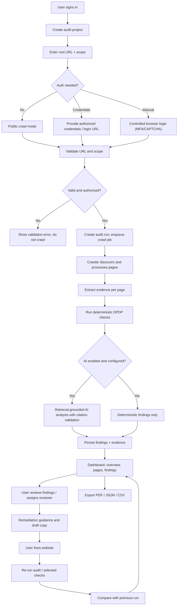
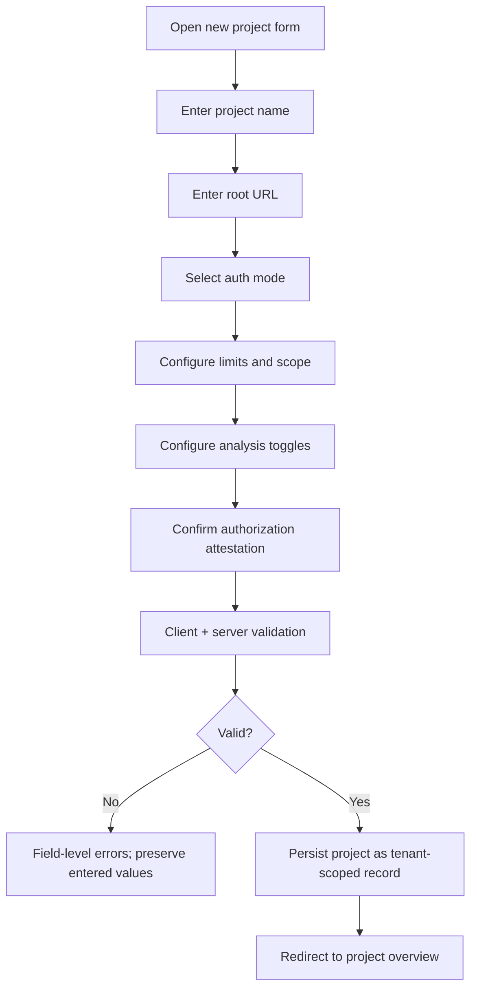
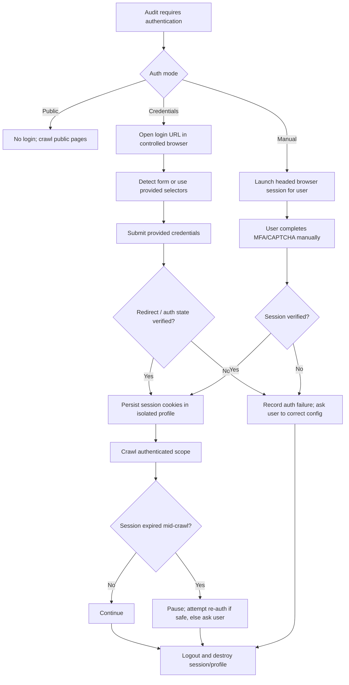
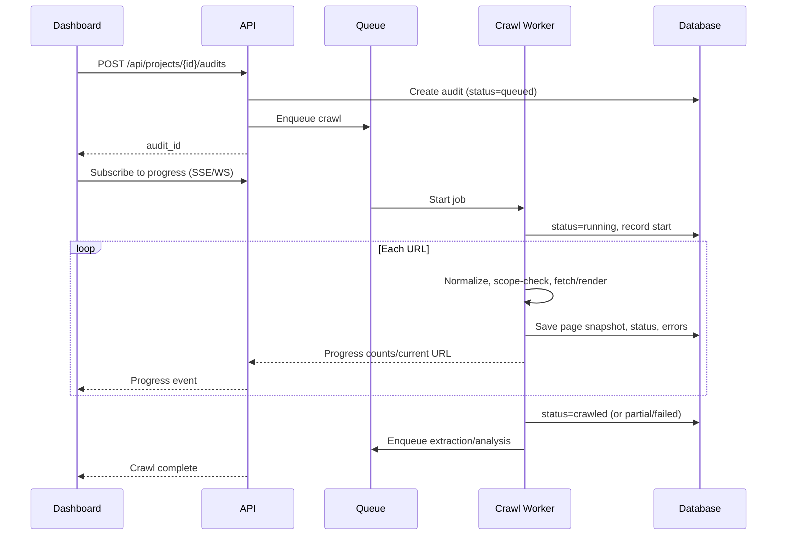
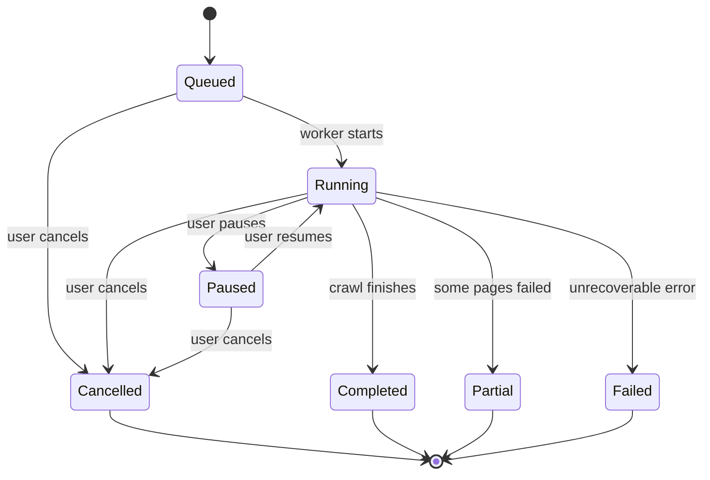
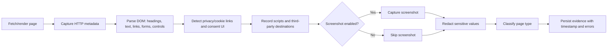
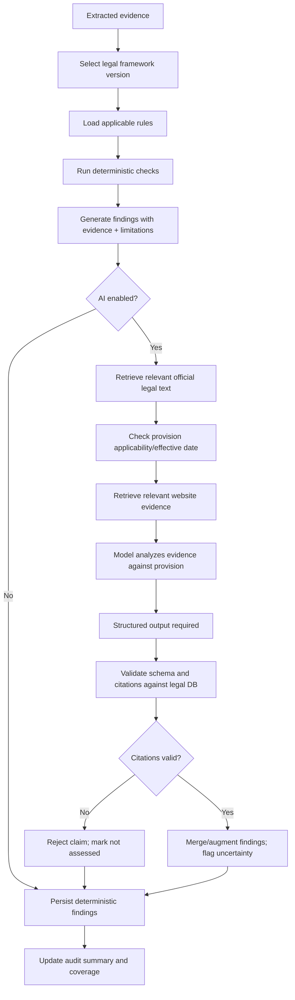
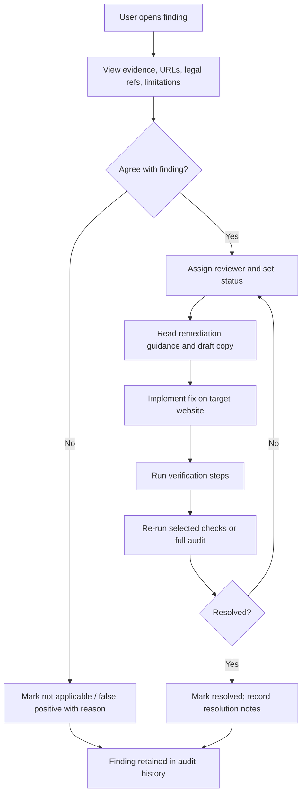
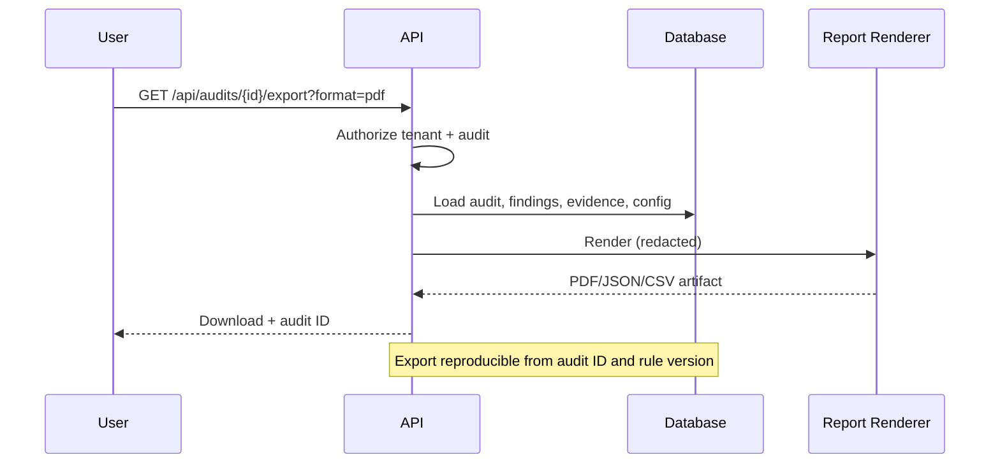

# FLOW.md — Application and Business Flows

**Last updated:** 2026-10-19

The implemented flow is the audit dashboard: a user submits an authorized URL, the app queues a run, a detached worker crawls and evaluates it, and the results appear in the dashboard. All other product flows below are **Proposed** based on the requirements and are not implemented.

## 1. Current Flow (Implemented)

The earlier single-page landing inspector was removed on 2026-10-19. There is still no authentication, database, or queue; runs are queued in-process and executed by a detached worker, with a file-backed store.

When screenshot capture is enabled, the worker stores a full-page screenshot and element crops under `.data/audits/<runId>/screenshots/`; the detail view renders them for each finding, the browser snapshots, and a run-level gallery via `/api/audits/{id}/screenshots/{name}`.

## 2. Target End-to-End Audit Flow (Proposed)

## 3. Project Creation and Validation Flow (Proposed)

Validation must include:

- URL scheme must be `http` or `https`; no embedded credentials.
- Host must not be localhost, a private IP, or a metadata endpoint.
- Depth, page count, concurrency, delay, timeout, and file size within bounds.
- Include/exclude paths syntactically valid.
- Credentials required only when auth mode is credentials-based.
- Approved subdomains must belong to a plausible related domain and be explicitly listed.

## 4. Authentication (Target Website) Flow (Proposed)

Rules:

- Never bypass MFA/CAPTCHA or access controls.
- Verify authenticated state by checking a protected page or expected user indicator, not just the absence of a login form.
- Credentials and cookies never appear in logs or exports.
- Sessions are not shared across projects or tenants.

## 5. Crawl and Progress Flow (Proposed)

Progress events must report real values: discovered, queued, processed, failed, skipped, retries, current URL, queue depth. **No fabricated percentage or ETA.**

Pause/resume/cancel:

Cancellation must clean up browser sessions, credentials in memory, and temporary artifacts according to retention policy.

## 6. Evidence Extraction Flow (Proposed)

## 7. Compliance Analysis Flow (Proposed)

## 8. Finding Review and Remediation Flow (Proposed)

## 9. Export Flow (Proposed)

## 10. Re-audit and Comparison Flow (Proposed)

1. User selects an audit to re-run (full or selected checks).
2. System creates a new audit run using the same project configuration and legal framework version (or a newly selected version, recorded).
3. Crawl and analysis execute.
4. Findings are matched across runs using stable rule IDs and normalized affected URLs.
5. Dashboard shows: new, resolved, unchanged, regressed findings; coverage changes; configuration changes.
6. Prior audit evidence is retained per retention policy.

## 11. Error and Failure Paths (Proposed)

| Failure | User-visible behavior | System behavior |
| --- | --- | --- |
| Invalid target URL | Field error with reason | No job created |
| Blocked destination (private/metadata) | Explicit blocked message | Attempt logged; no request |
| Auth failure | Actionable message; config link | Audit marked auth-failed; no authenticated claims |
| Session expiry | Paused state with re-auth prompt | Stop authenticated crawling; cleanup |
| Crawl timeout | Page marked failed with reason | Continue within limits |
| Parse failure | Page marked partial; evidence available if any | Record extraction error |
| Worker crash | Audit shows failed/interrupted | Recovery or resumable job; no silent success |
| AI unavailable | Findings remain deterministic | Record AI as skipped/unavailable |
| Invalid AI citation | Claim rejected | Finding marked not assessed/needs review |
| Export failure | Error with retry | Log correlation ID; no partial download |
| Permission denied | Access denied message | No resource details leaked |

## 12. Related Documents

- [FEATURES.md](./FEATURES.md) — features supporting these flows.
- [ARCHITECTURE.md](./ARCHITECTURE.md) — components and data flow.
- [API.md](./API.md) — endpoints used by flows.
- [SECURITY.md](./SECURITY.md) — constraints on auth and crawling.
- [PRD.md](./PRD.md) — requirements behind flows.
